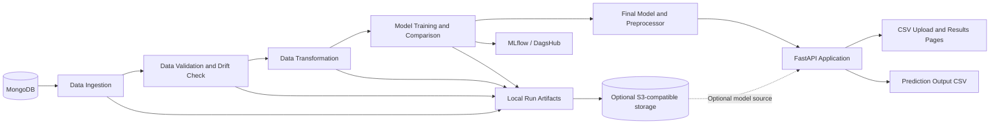

# 🛡️ Network Security: End-to-End Data Science & MLOps Platform

[](https://www.python.org/)
[](https://fastapi.tiangolo.com/)
[](https://scikit-learn.org/)
[](https://mlflow.org/)
[](https://www.docker.com/)
[](https://render.com/)

A modular machine-learning application for analyzing network and URL security
records. The project includes a MongoDB-backed training pipeline, dataset
validation and drift reporting, model comparison and experiment tracking, an
S3-compatible artifact sync utility, and a FastAPI interface for CSV-based
inference.

---

## 📑 Table of Contents

- [System Architecture](#-system-architecture)
- [ML Pipeline Workflow](#-ml-pipeline-workflow)
- [Project Directory Structure](#-project-directory-structure)
- [Tech Stack](#-tech-stack)
- [Getting Started](#-getting-started)
  - [Prerequisites](#prerequisites)
  - [Installation](#installation)
  - [Environment Configuration](#environment-configuration)
- [Usage & Execution](#-usage--execution)
  - [Run the Web Application](#1-run-the-web-application)
  - [Run the Training Pipeline](#2-run-the-training-pipeline)
- [API Endpoints](#-api-endpoints)
- [Docker](#-docker)
- [CI/CD and Render Deployment](#-cicd-and-render-deployment)
- [Experiment Tracking and Artifacts](#-experiment-tracking-and-artifacts)
- [Troubleshooting](#-troubleshooting)
- [Author](#-author)

---

## 🏛 System Architecture

The application separates data processing into pipeline components and serves
saved models through a FastAPI web application.



---

## 🔄 ML Pipeline Workflow

| Stage | Name | Description | Main outputs |
| :---: | :--- | :--- | :--- |
| **01** | **Data Ingestion** | Reads the configured `phisingData` collection from MongoDB, saves a feature-store CSV, and creates train/test splits. | `train.csv`, `test.csv` |
| **02** | **Data Validation** | Checks dataset columns and numeric types against the schema and generates a drift report. | Validated/invalid datasets, `report.yaml` |
| **03** | **Data Transformation** | Separates the `Result` target, fits a preprocessing pipeline with KNN imputation, and writes transformed arrays. | `train.npy`, `test.npy`, preprocessing object |
| **04** | **Model Training** | Compares Random Forest, Decision Tree, Gradient Boosting, Logistic Regression, and AdaBoost classifiers; saves the selected model and classification metrics. | Trained model, train/test metrics |
| **05** | **Artifact Sync** | Optionally uploads run artifacts and final model files to an S3-compatible bucket when `TRAINING_BUCKET_NAME` is configured. | `artifacts/<timestamp>/`, `final_model/<timestamp>/` |

---

## 📁 Project Directory Structure

```text
Enterprise-Grade-DataScience-Project/
├── app.py                              # FastAPI app and inference routes
├── Dockerfile                          # Container build and start configuration
├── requirements.txt                    # Python dependencies
├── data_schema/
│   └── schema.yaml                     # Dataset columns and types
├── final_model/
│   ├── model.pkl                       # Trained classifier
│   └── preprocessor.pkl                # Fitted preprocessing pipeline
├── networksecurity/
│   ├── cloud/
│   │   └── s3_sync.py                  # S3-compatible upload/download helper
│   ├── components/
│   │   ├── data_ingestion.py
│   │   ├── data_validation.py
│   │   ├── data_transformation.py
│   │   └── model_trainer.py
│   ├── entity/                         # Pipeline config and artifact types
│   ├── exception/                      # Custom exception handling
│   ├── logging/                        # Application logging
│   ├── pipeline/
│   │   └── training_pipeline.py        # Training pipeline orchestration
│   └── utils/                          # Serialization, evaluation, and ML helpers
├── template/
│   ├── index.html                      # CSV upload interface
│   └── results.html                    # Prediction results interface
└── .github/
    └── workflows/
        └── main.yml                    # Validation, image build, Render trigger
```

---

## 🛠 Tech Stack

- **Language:** Python
- **API and templates:** FastAPI, Uvicorn, Jinja2
- **Data processing:** pandas, NumPy, SciPy
- **Machine learning:** scikit-learn
- **Data source for training:** MongoDB
- **Experiment tracking:** MLflow and DagsHub
- **Object storage integration:** boto3 with S3-compatible APIs (including
  local Floci)
- **Containerization and deployment:** Docker, GitHub Actions, Render

---

## 🚀 Getting Started

### Prerequisites

- Python 3.14 or Docker
- Git
- MongoDB access to run training
- Floci running locally only if you want to load models from local S3-compatible
  storage

### Installation

Clone the repository and enter the project directory:

```bash
git clone https://github.com/sheshpalsingh01/Enterprise-Grade-DataScience-Project.git
cd Enterprise-Grade-DataScience-Project
```

Create and activate a virtual environment:

```bash
python3.14 -m venv .venv
source .venv/bin/activate
```

On Windows PowerShell, activate it with:

```powershell
.\.venv\Scripts\Activate.ps1
```

Install the dependencies:

```bash
python -m pip install --upgrade pip
python -m pip install -r requirements.txt
```

### Environment Configuration

Create a local `.env` file from `.env.example`, or add the settings you need to
your existing `.env` without replacing other project variables:

```dotenv
# Optional: load models from local Floci S3
FLOCI_S3_ENDPOINT_URL=http://localhost:4566
AWS_DEFAULT_REGION=us-east-1
AWS_ACCESS_KEY_ID=test
AWS_SECRET_ACCESS_KEY=test
TRAINING_BUCKET_NAME=my-first-bucket
MODEL_S3_PREFIX=final_model/<run-timestamp>

# Required only to run the training pipeline
MONGODB_URI=<your-mongodb-connection-string>
```

Set `MODEL_S3_PREFIX` to the folder containing both PKL files. If they are
stored in the bucket root, leave the prefix empty. For local inference without
Floci, unset `TRAINING_BUCKET_NAME`; the app then uses the model files under
`final_model/`.

Do not commit `.env` or paste real credentials into source code. The `.env`
file is ignored by Git and excluded from the Docker build.

---

## 💻 Usage & Execution

### 1. Run the Web Application

Start FastAPI from the project root:

```bash
python -m uvicorn app:app --reload --host 0.0.0.0 --port 7000
```

Open [http://localhost:7000](http://localhost:7000), choose a CSV file, and
select **Analyze dataset**. A results page displays the original records with
the `predicted_column` appended.

The CSV must include the 30 model feature columns defined in
`data_schema/schema.yaml`. An optional `Result` column is accepted but is not
used as a prediction feature.

### 2. Run the Training Pipeline

Training requires a valid `MONGODB_URI` and access to the configured MongoDB
database/collection. Run the orchestration pipeline with:

```bash
python -c "from networksecurity.pipeline.training_pipeline import TrainingPipeline; TrainingPipeline().run_pipeline()"
```

The pipeline writes run artifacts under `artifacts/`. If `TRAINING_BUCKET_NAME`
is configured, it also attempts to upload artifacts and the final model files
to the configured S3-compatible service. Model training also initializes the
project's DagsHub/MLflow tracking integration.

---

## 🌐 API Endpoints

| HTTP Method | Route | Description |
| :--- | :--- | :--- |
| `GET` | `/` | Renders the CSV upload page. |
| `GET` | `/train` | Starts the complete training pipeline. |
| `POST` | `/predict` | Accepts a multipart CSV upload and renders predictions as HTML. |

Example prediction request:

```bash
curl -X POST \
  -F "file=@Network_Data/phisingData.csv" \
  http://localhost:7000/predict
```

The prediction response is an HTML results page. A copy of the output CSV is
also written to `prediction_output_data/output.csv` in the running environment.
That directory is ephemeral in most containers and should not be used for
long-term storage.

---

## 🐳 Docker

Build the image from the project root:

```bash
docker build -t network-security-app .
```

Run locally with Floci running on the host:

```bash
docker run --rm --name network-security-app \
  --env-file .env \
  --add-host=host.docker.internal:host-gateway \
  -e FLOCI_S3_ENDPOINT_URL=http://host.docker.internal:4566 \
  -p 8000:7000 \
  network-security-app
```

Open [http://localhost:8000](http://localhost:8000). The container binds to the
platform-provided `PORT` variable when set, and defaults to `7000`.

---

## 🚀 CI/CD and Render Deployment

The GitHub Actions workflow at `.github/workflows/main.yml`:

1. Compiles the Python application sources on pull requests and pushes to
   `main`.
2. Builds the Docker image.
3. Publishes the image to GitHub Container Registry on pushes to `main`.
4. Triggers the Render deployment hook after a successful `main` build.

To enable automatic deployment:

1. Create a Render Web Service from this repository.
2. Choose **Docker**, select branch `main`, and leave **Root Directory** empty
   when the Dockerfile is at the repository root.
3. Create a deploy hook in the Render service settings.
4. Add the complete hook URL to GitHub under **Settings → Secrets and variables
   → Actions** as `RENDER_DEPLOY_HOOK_URL`.
5. Disable Render automatic deploys if GitHub Actions should be the only deploy
   trigger.

The app's tracked local model files are included in the Docker image, so
Render does not need to access local Floci. Never configure a cloud service
with `localhost` or `host.docker.internal` as its Floci endpoint.

Render's free web service plan may sleep after inactivity, has limited memory,
and is intended for testing or hobby projects. Check Render's current plan
limits and deployment logs if the service fails to start.

---

## 📊 Experiment Tracking and Artifacts

Training compares five classification estimators and records the selected
model's train/test classification metrics. MLflow tracking is initialized
through DagsHub in the model-training component.

Generated training artifacts are stored locally under a timestamped
`artifacts/` directory. When configured, S3-compatible storage receives:

- `artifacts/<run-timestamp>/...`
- `final_model/<run-timestamp>/model.pkl`
- `final_model/<run-timestamp>/preprocessor.pkl`

Prediction models loaded from S3 are cached in the app process. Restart the
application after replacing the model objects or changing their prefix.

---

## 🧰 Troubleshooting

### `Prediction failed` or an S3 `404`

Confirm the bucket contains both `model.pkl` and `preprocessor.pkl`. Set
`MODEL_S3_PREFIX` to their exact parent folder, then restart the app. If using
local model files instead, unset `TRAINING_BUCKET_NAME`.

### CSV columns do not match

Use the feature names from `data_schema/schema.yaml`. The `Result` target is
optional and excluded from model input; other unexpected columns are rejected.

### Training cannot connect to MongoDB

Check `MONGODB_URI`, network access, and database permissions. Training reads
the configured `phisingData` collection; web prediction does not require
MongoDB.

### Render deployment fails

Confirm the service uses the **Docker** runtime and the correct repository and
branch. Review Render logs for memory or startup errors. Confirm the GitHub
Actions secret `RENDER_DEPLOY_HOOK_URL` is configured and that validation and
image build jobs succeeded.

---

## 👤 Author

Developed by **Sheshpal Singh**.

- GitHub: [@sheshpalsingh01](https://github.com/sheshpalsingh01)
- Project: [Enterprise-Grade-DataScience-Project](https://github.com/sheshpalsingh01/Enterprise-Grade-DataScience-Project)
